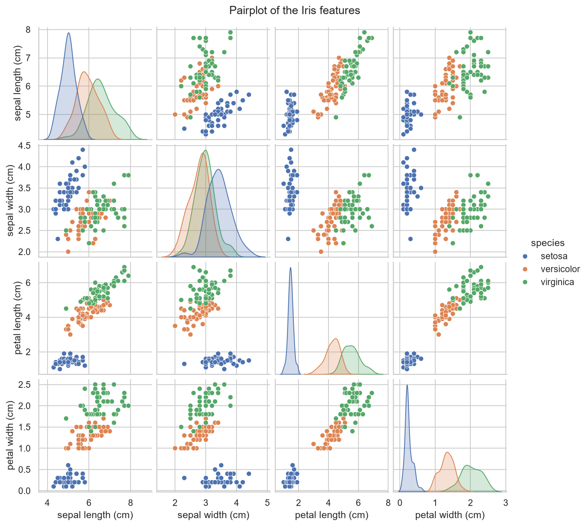
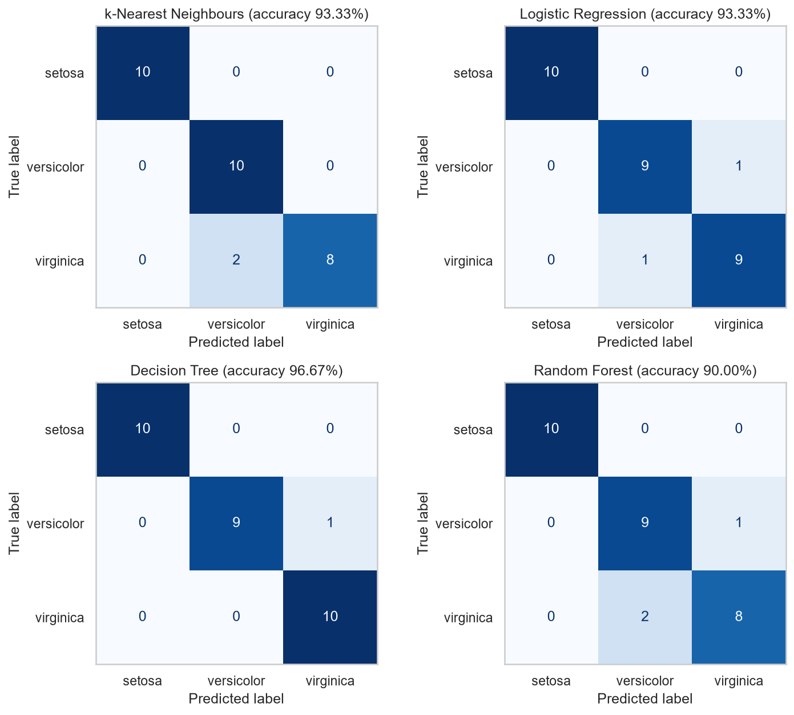

# 🌸 Iris Flower Classification

**Oasis Infobyte Internship Program (OIBSIP) · Data Science · Task 1**

| | |
|---|---|
| **Author** | Rini Ramadhan Naim |
| **Track** | Data Science |
| **Task** | Task 1 — Iris Flower Classification |
| **Tech stack** | Python, pandas, scikit-learn, matplotlib, seaborn, Jupyter Notebook |

## 🎯 Objective

Train machine learning models that identify the species of an iris flower (Setosa, Versicolor or Virginica) from its four physical measurements, then compare the models and declare the best one.

## 📊 Dataset

The Iris dataset is built into scikit-learn (`load_iris`), so no download is needed.

- 150 flowers, 50 per species (balanced classes)
- 4 numeric features: sepal length, sepal width, petal length, petal width (cm)
- No missing values

## 🔍 What the notebook does

1. **Setup:** import libraries and set a fixed random seed
2. **Load the dataset** into a pandas DataFrame
3. **EDA:** shape, data types, null values, duplicates, descriptive statistics, class balance
4. **Visualisations:** pairplot, box plots by species, correlation heatmap
5. **Feature selection discussion:** petal length and petal width are the most discriminative
6. **Train/test split:** 80/20, stratified
7. **Model training and evaluation:** accuracy, confusion matrix, classification report
8. **Model comparison:** test accuracy and 5-fold stratified cross-validation
9. **Feature importance** (Random Forest) and a prediction on a new flower
10. **Conclusion**

## 🤖 Models

- k-Nearest Neighbours (k=5)
- Logistic Regression
- Decision Tree (max_depth=3)
- Random Forest (200 trees)

## 📈 Key findings

- Setosa is classified perfectly by all models.
- All mistakes are between Versicolor and Virginica.
- Petal length and petal width carry most of the information (about 87% of the Random Forest feature importance).
- All models reach roughly 95% to 97% cross-validated accuracy. The differences are smaller than the standard deviation, so the ranking is a preference, not a proven winner.
- The test set has only 30 flowers, so cross-validation gives a more reliable comparison.

## ▶️ How to run

```bash
pip install numpy pandas matplotlib seaborn scikit-learn jupyter
jupyter notebook IrisClassification.ipynb
```

## 📁 Files

- `IrisClassification.ipynb`: the complete, commented notebook
- `README.md`: this file

## 🎥 Demo video

Link to the LinkedIn post: https://lnkd.in/p/gmanvgF7

## Results



---

*#oasisinfobyte · #datascience · #python*
